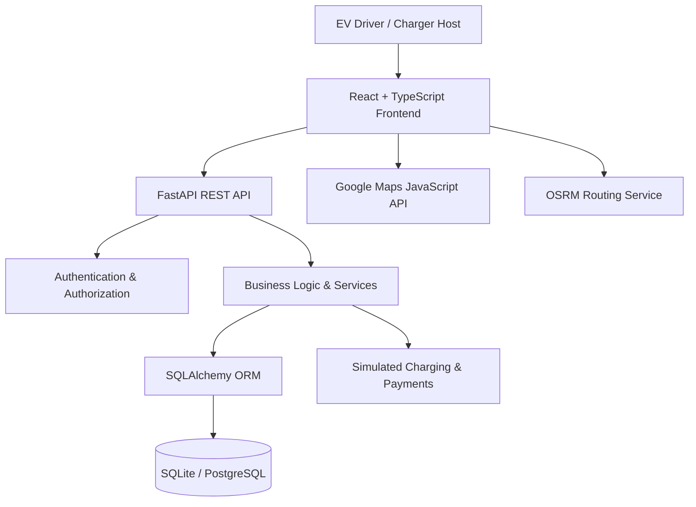
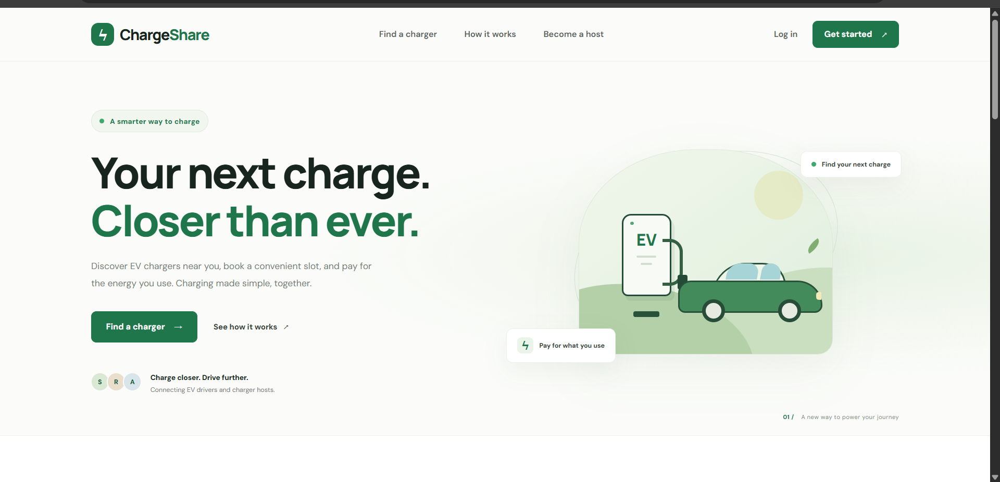
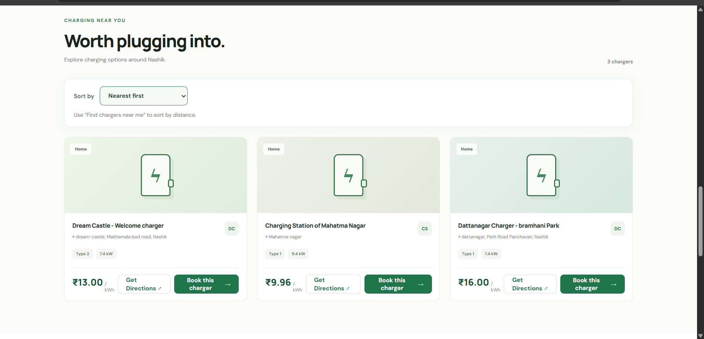
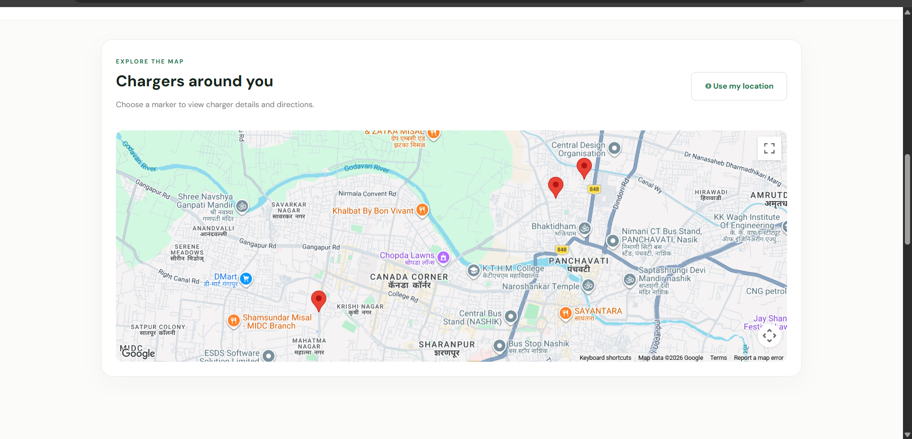
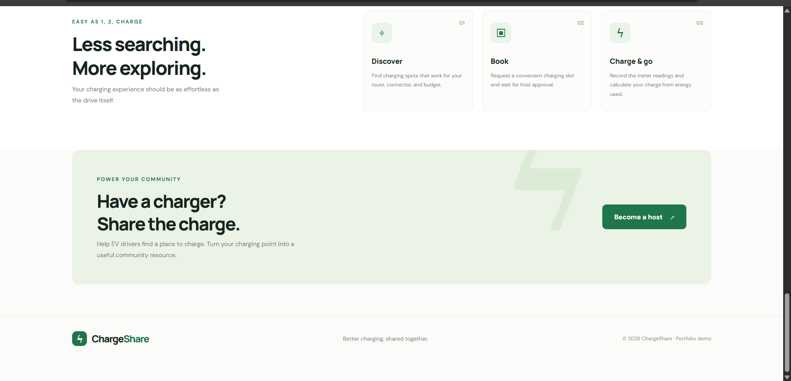

# ChargeShare – EV Charging Marketplace

A full-stack, peer-to-peer EV charging marketplace that connects EV drivers with charger owners. Drivers can discover charging stations, view charger details, and request bookings, while hosts can list chargers, manage reservations, monitor charging sessions, and track simulated earnings.

**Repository:** [github.com/sudarshansanap9/ChargeShare](https://github.com/sudarshansanap9/ChargeShare)

> **Important:** ChargeShare is a portfolio demonstration. Charging sessions, electricity consumption, and payments are simulated. The application does not control physical charging hardware, independently measure electricity, or process real financial transactions. Use fictional/demo data only.

## Features

### Driver
- Register and log in using a driver account.
- Discover available charging stations.
- View charger location, connector type, charging power, and pricing.
- Explore chargers using an interactive map.
- Request charging-slot bookings.
- View booking status and charging history.
- View completed session details and simulated charging costs.

### Host
- Register and log in using a host account.
- List and manage charging stations.
- Configure charger specifications and pricing.
- View and manage incoming booking requests.
- Approve or reject bookings.
- Start and complete simulated charging sessions.
- Submit start and end meter readings with evidence references and optional notes.
- View earnings summaries, monthly earnings, and transaction history.

### Mapping and navigation
- Google Maps JavaScript API integration for map display.
- Location-aware charger discovery.
- Current-location support where browser permissions allow.
- Road-route calculation using OSRM.
- Route distance and estimated travel duration.
- External Google Maps navigation.

### Security and application design
- JWT-based authentication.
- Password hashing.
- Driver and host role-based access.
- Protected API endpoints.
- Request and response validation using Pydantic.
- Responsive dashboard layouts.
- RESTful API architecture.

## Technology Stack

| Layer | Technologies |
|---|---|
| Frontend | React 19, TypeScript, Vite |
| Routing | React Router |
| API communication | Axios |
| Backend | Python, FastAPI |
| Database | SQLite (default), PostgreSQL configuration supported |
| ORM | SQLAlchemy |
| Authentication | JWT, password hashing |
| Validation | Pydantic |
| Mapping | Google Maps JavaScript API |
| Road routing | OSRM |
| Testing | Pytest, Vitest, React Testing Library |
| Code quality | ESLint, TypeScript |

## System Architecture



### Application workflow

1. Users register and authenticate.
2. Drivers discover chargers and request bookings.
3. Hosts review and manage booking requests.
4. Approved bookings can be used to initiate simulated charging sessions.
5. Start and end meter readings are submitted.
6. The backend calculates simulated energy consumption and charges.
7. Payment and earnings information is made available through the dashboards.

## Repository Structure

```text
ChargeShare/
├── backend/
│   ├── app/
│   │   ├── api/
│   │   │   └── routes/
│   │   │       ├── auth.py
│   │   │       ├── chargers.py
│   │   │       ├── bookings.py
│   │   │       ├── charging_sessions.py
│   │   │       ├── payments.py
│   │   │       └── earnings.py
│   │   ├── core/
│   │   ├── db/
│   │   ├── models/
│   │   ├── schemas/
│   │   ├── services/
│   │   └── main.py
│   ├── tests/
│   ├── requirements.txt
│   └── .env.example
│
├── frontend/
│   ├── src/
│   │   ├── assets/
│   │   ├── components/
│   │   ├── lib/
│   │   ├── pages/
│   │   └── test/
│   ├── package.json
│   └── .env.example
│
├── docs/
├── scripts/
├── .gitignore
└── README.md
```

## Getting Started

### Prerequisites

Install the following:

- Python 3.11 or newer
- Node.js and npm compatible with Vite 8
- Git
- Google Maps API key with the Maps JavaScript API enabled

### 1. Clone the repository

```bash
git clone https://github.com/sudarshansanap9/ChargeShare.git
cd ChargeShare
```

### 2. Configure the backend

Create and activate a virtual environment.

**Windows PowerShell:**

```powershell
cd backend

py -3.11 -m venv .venv
.\.venv\Scripts\Activate.ps1

python -m pip install --upgrade pip
pip install -r requirements.txt

Copy-Item .env.example .env
```

**macOS/Linux:**

```bash
cd backend

python3 -m venv .venv
source .venv/bin/activate

python -m pip install --upgrade pip
pip install -r requirements.txt

cp .env.example .env
```

Configure your backend environment variables in `backend/.env`:

```env
APP_NAME=ChargeShare API
ENVIRONMENT=development
DATABASE_URL=sqlite:///./chargeshare.db
JWT_SECRET_KEY=replace-with-a-long-random-secret
JWT_ALGORITHM=HS256
ACCESS_TOKEN_EXPIRE_MINUTES=30
CORS_ORIGINS=http://localhost:5173,http://127.0.0.1:5173
```

Use a unique, secure JWT secret for your local environment. Never commit actual secrets.

### 3. Start the backend

From the `backend` directory:

```bash
uvicorn app.main:app --reload
```

Backend URLs:

- API: http://127.0.0.1:8000
- Interactive Swagger documentation: http://127.0.0.1:8000/docs
- ReDoc: http://127.0.0.1:8000/redoc
- Health check: http://127.0.0.1:8000/health

### 4. Configure the frontend

Open a second terminal and navigate to the frontend:

```bash
cd frontend
npm install
```

Create `frontend/.env.local` with:

```env
VITE_API_BASE_URL=http://127.0.0.1:8000
VITE_GOOGLE_MAPS_API_KEY=your_google_maps_api_key
```

Replace the Google Maps placeholder with your own API key.

Restrict the key to the required Google Maps API and your development website origins. Never commit `.env.local`.

### 5. Start the frontend

From the `frontend` directory:

```bash
npm run dev
```

Open:

http://localhost:5173

The backend and frontend must both be running for the application to work correctly.

## API Documentation

All application API routes use the `/api/v1` prefix.

| Module | Base path | Functionality |
|---|---|---|
| Authentication | `/api/v1/auth` | Registration, login, current-user profile |
| Chargers | `/api/v1/chargers` | Charger creation, discovery, details, updates and deletion |
| Bookings | `/api/v1/bookings` | Booking requests, driver/host booking views and status management |
| Charging sessions | `/api/v1/charging-sessions` | Session management, meter readings and completion |
| Payments | `/api/v1/payments` | Simulated booking payments |
| Earnings | `/api/v1/earnings` | Earnings summary, monthly earnings and transactions |

For complete endpoint paths, request schemas, response models, and interactive API testing, start the backend and visit:

http://127.0.0.1:8000/docs

## Running Tests

### Backend tests

From the `backend` directory:

```bash
python -m pytest
```

### Frontend tests

From the `frontend` directory:

```bash
npm run test:run
```

### Frontend linting

```bash
npm run lint
```

### Production build

```bash
npm run build
```

**Latest verified project test results:**

| Test suite | Result |
|---|---:|
| Backend Pytest | 44 passed |
| Frontend Vitest | 33 passed |
| Frontend ESLint | Passed |
| TypeScript compilation and Vite build | Passed |

These results reflect the project at the time this README was prepared.
## Screenshots

### Homepage


### Charger Discovery


### Interactive Map


### How It Works and Host Onboarding


## Design and Demo Limitations

- Charging sessions are simulated; no physical EV charger is controlled.
- Meter readings are submitted as application data and are not independently verified by hardware.
- Payments are simulated; no real payment gateway or financial settlement is involved.
- OSRM provides road-route calculations; route availability depends on the external service.
- Google Maps functionality requires a valid API key and enabled APIs.
- The application is intended for demonstration and portfolio purposes, not production deployment.

## Future Enhancements

- Real EV charger hardware integration.
- Production payment gateway integration.
- Real-time charger availability.
- Booking notifications and reminders.
- Advanced analytics and reporting.
- Automated deployment and CI/CD.
- Production database migrations and deployment hardening.

## Author

**Sudarshan Sanap**

Computer Engineering Graduate | Postgraduate Diploma in Data Science and Artificial Intelligence

GitHub: [@sudarshansanap9](https://github.com/sudarshansanap9)

---

If you find this project useful, consider giving the repository a star!
